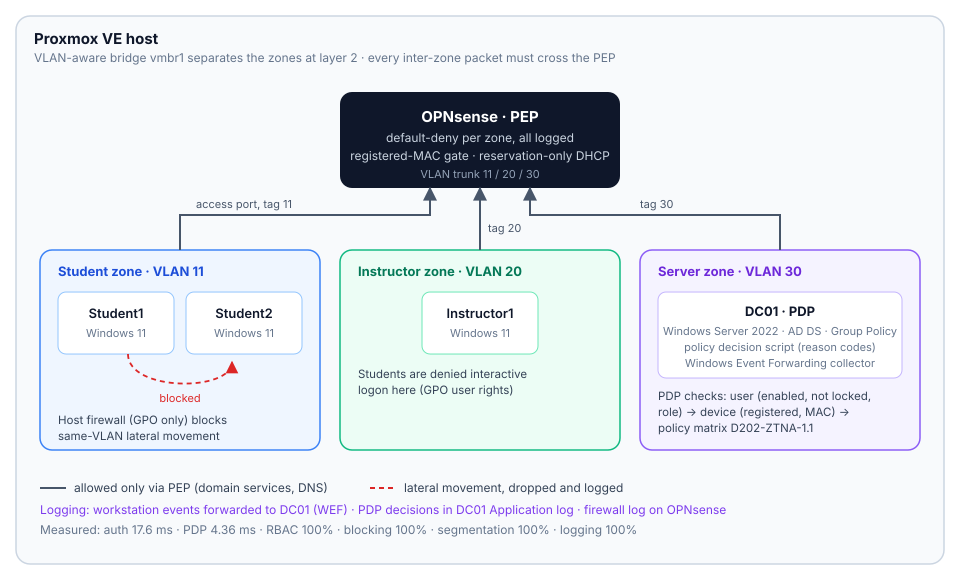
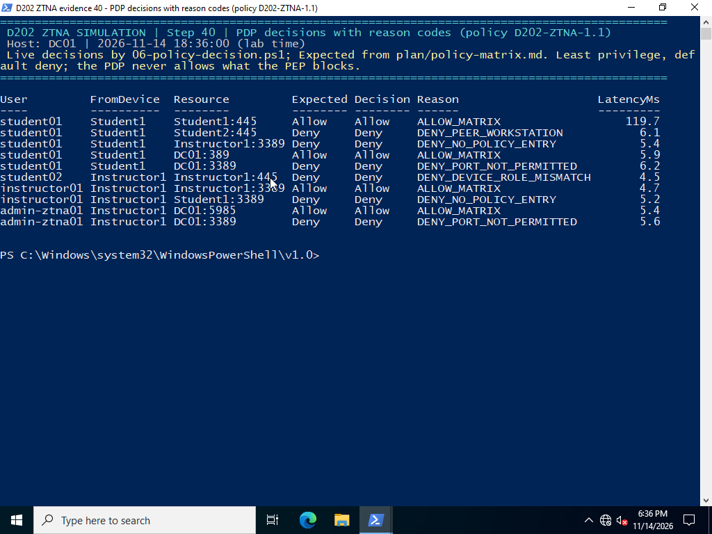
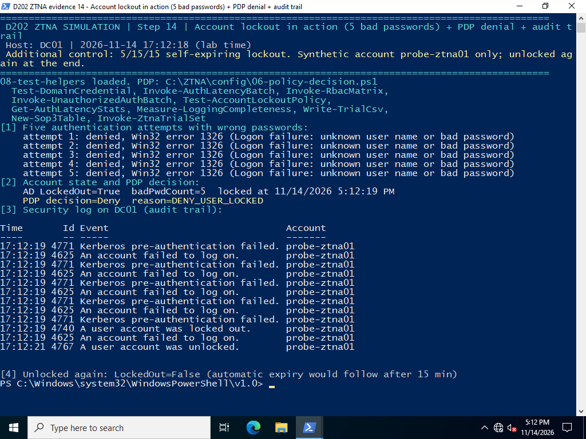
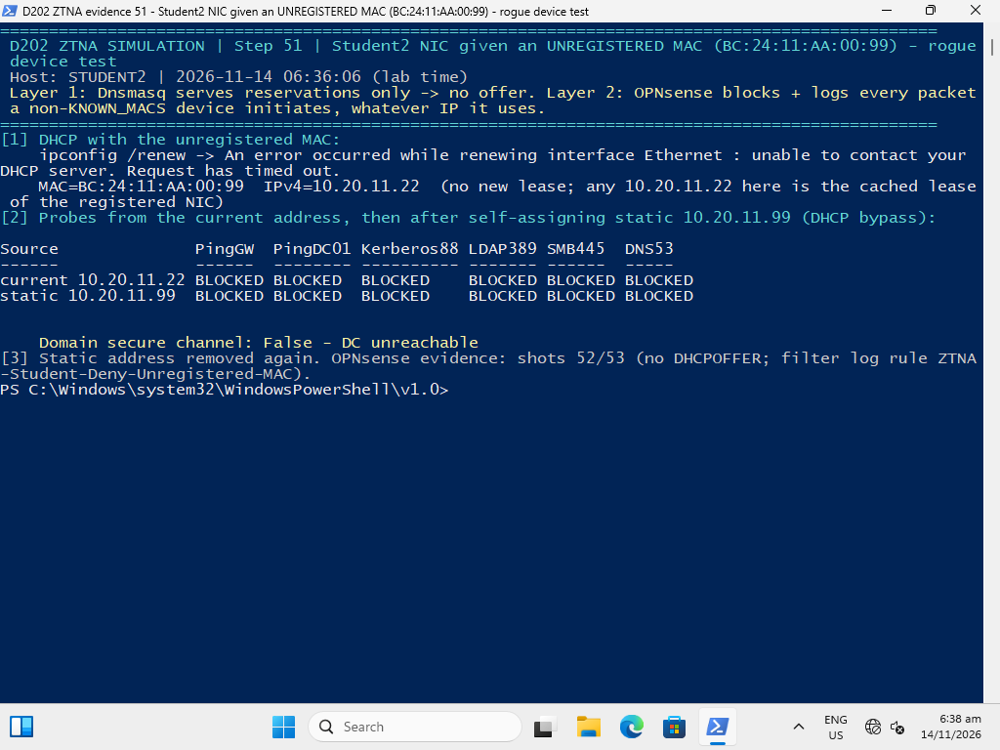
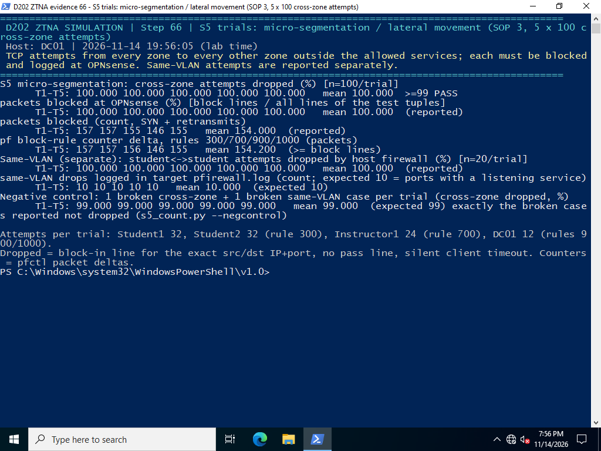

# Zero Trust Network Access for a university computer lab

**A working Zero Trust model, built on a virtual test-bed and measured against six engineering thresholds.
It passed all six.**

Undergraduate thesis project (team), University of Baguio, 2026. **Case-study site:** see the `docs/` folder
(published with GitHub Pages).

## The problem

Shared computer labs are a flat network. Every PC sits on the same switching layer, so a device inside the lab is
implicitly trusted. One compromised or borrowed machine can reach the instructor's PC and the server. Students
rotate every term, and the PCs are shared by many users.

## The approach

The project applies the NIST SP 800-207 Zero Trust model: *never trust, always verify*. Each request is
judged on **who** the user is, **what role** they hold, **which device** they use, and **what** they want to
reach.

| Zero Trust component | Implementation |
|---|---|
| Policy Decision Point (PDP) | Active Directory (identity, roles, lockout, logon rights) + a PowerShell policy engine that returns Allow/Deny with a reason code ([`code/pdp`](code/pdp)) |
| Policy Enforcement Point (PEP) | OPNsense firewall routing between three VLAN zones, default-deny and logged per zone; Windows host firewall controlled only by Group Policy |
| Role-based access control | Role groups + Group Policy logon rights; a versioned policy matrix ([`design/policy-matrix.md`](design/policy-matrix.md)) that matches the firewall exactly |
| Device validation | Reservation-only DHCP (unknown MACs get no address), a registered-MAC firewall gate, and domain membership checked by the PDP |
| Continuous monitoring | Windows Event Forwarding to the domain controller, PDP decision events, and the firewall log |

## Test-bed

Five virtual machines on Proxmox VE, separated by a VLAN-aware bridge:

| VM | Role |
|---|---|
| DC01: Windows Server 2022 | AD DS, Group Policy, PDP, event collector (Server zone, VLAN 30) |
| OPNsense 26.7 | PEP, router between zones, DHCP (VLAN trunk) |
| Instructor1: Windows 11 | Instructor zone, VLAN 20 |
| Student1, Student2: Windows 11 | Student zone, VLAN 11 |

All user accounts are synthetic. No real person's data was used.

## Results

Each indicator was measured in **5 independent trials of 100 events**, and the five-trial mean was compared with
the threshold:

| Indicator | Threshold | Result |
|---|---|---|
| Authentication latency (end-to-end at the workstation) | ≤ 300 ms, mean and p95 | **17.6 ms** (p95 19.8 ms) |
| Policy decision latency | ≤ 200 ms | **4.36 ms** |
| RBAC enforcement accuracy | ≥ 99% | **100%** |
| Unauthorized authentication blocking (brute force, wrong role, unknown/disabled accounts, rogue devices) | ≥ 99% | **100%** |
| Micro-segmentation: cross-zone lateral-movement attempts dropped | ≥ 99% | **100%** |
| Logging completeness (granted and denied events) | 100% | **100%** |

Per-trial tables: [`results/`](results).

## Making the numbers trustworthy

Getting to 100% is easy if the test grades itself. These safeguards prevent that:

- **Fixed case files** were written before each test. The expected answers were derived from the policy
  document, not from the system under test ([`code/tests/gen_cases.py`](code/tests/gen_cases.py)).
- **Every trial ran as a fresh process**, with the case order shuffled (seed = trial number) and times measured
  inside the VMs.
- **Every table was recomputed from the raw per-event records** (for example
  [`code/tests/sop3_s5.py`](code/tests/sop3_s5.py)), not from the test scripts' own summaries.
- **Independent evidence sources**: the firewall log, the forwarded Windows events and host firewall logs were
  matched on exact keys (source port, user, case ID) within time windows
  ([`code/tests/s5_count.py`](code/tests/s5_count.py), [`code/tests/s6_count.py`](code/tests/s6_count.py)).
- **Negative controls**: deliberately broken records were reported as missing, which proves the counters can
  fail.
- **Cache check**: the domain controller logged exactly one Kerberos request per measured logon, so no logon
  was served from cached credentials.

## What went wrong, and how it was fixed

The first RBAC run scored **95%**. Every request originating from the domain controller was denied. The cause
was a subtle bug: reading `.Value` on an AD `ResultPropertyValueCollection` silently returned nothing. That
made the account flags look like 0, which also hid disabled and locked accounts from the PDP. After the fix,
which was unit-tested on the failing cases first, accuracy reached 100%. That used two of the three refinement
cycles the method allowed.

Testing also exposed two configuration gaps: lockout events were not audited, and host-firewall drop logging was
never active (wrong policy key, missing log folder on the image). Both were fixed under VM snapshots and became
recommendations for a production rollout.

## Evidence

| | |
|---|---|
|  **Live PDP decisions with reason codes** |  **Brute force stopped by lockout, recorded in the audit trail** |
|  **Unregistered device: no address, all traffic blocked** |  **Micro-segmentation trials: 500/500 dropped** |

## Limitations

- Five VMs and synthetic users: latency may rise under real lab load.
- Lateral movement was tested with TCP connection attempts only.
- A MAC gate can be fooled by spoofing; domain membership is the second factor, and IEEE 802.1X is the
  production recommendation.

## Repository contents

| Folder | Contents |
|---|---|
| [`code/pdp`](code/pdp) | The policy decision engine (PowerShell) |
| [`code/windows`](code/windows) | Group Policy (logon rights, lockout, audit, host firewall) and Windows Event Forwarding |
| [`code/tests`](code/tests) | Case generation, network trial runner, log counters, SOP 3 table generators |
| [`design`](design) | Policy matrix, firewall rule set, test designs for segmentation and logging |
| [`results`](results) | Per-trial result tables |
| [`docs`](docs) | Case-study website and screenshots |

Lab-specific paths and addresses are left as they were in the test-bed. Credentials and configuration backups are
not included.

## Tools

Proxmox VE · Windows Server 2022 (AD DS, Group Policy, WEF) · Windows 11 · OPNsense · PowerShell · Python ·
Bash. AI pair-programming assistants (opencode, Claude Code) were used to configure, test and document the lab
under the team's direction.
